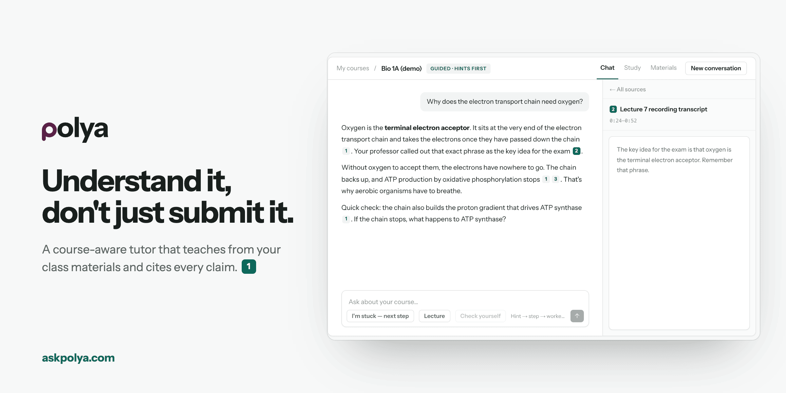
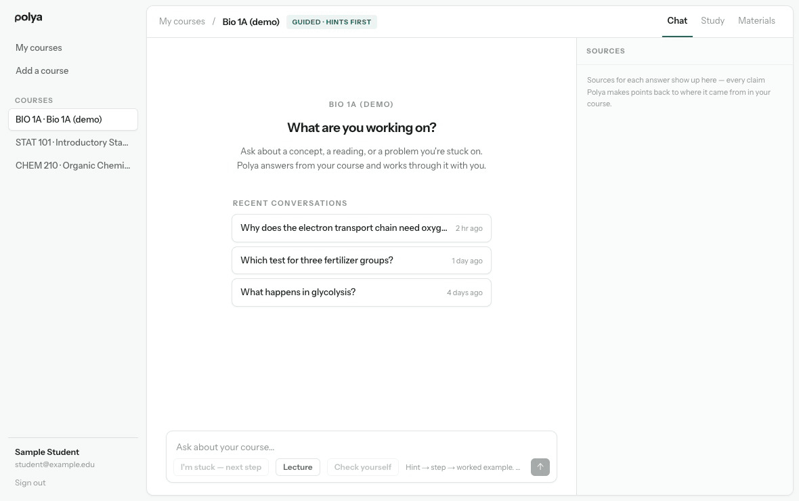
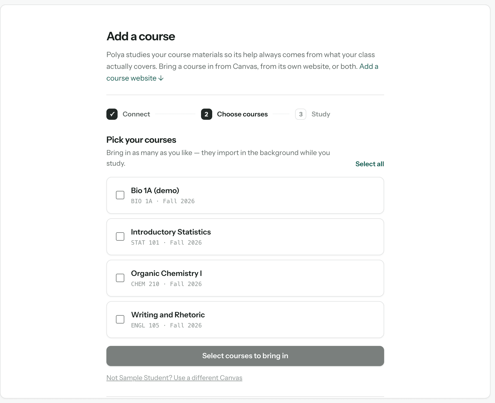
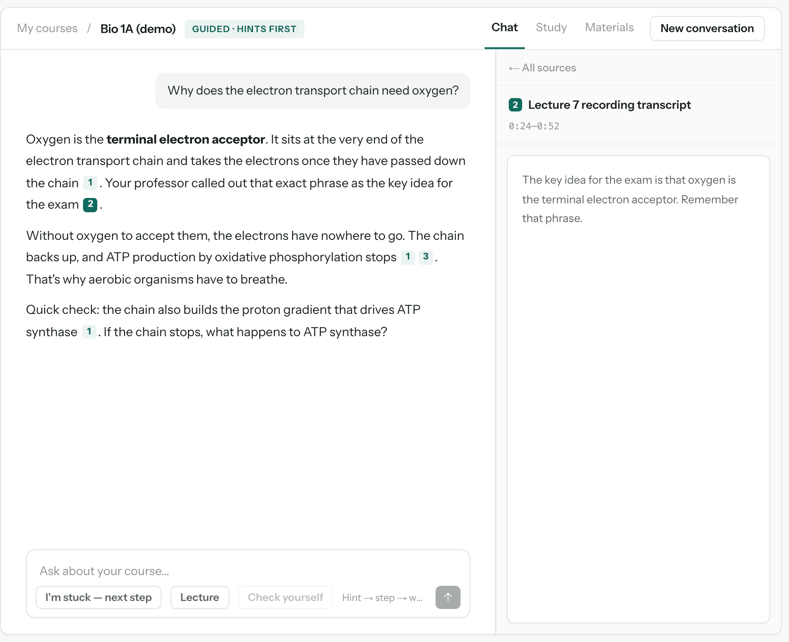
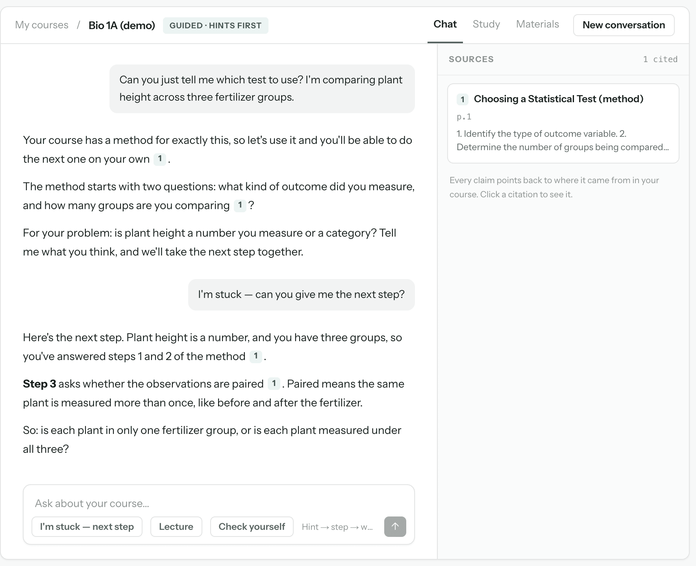
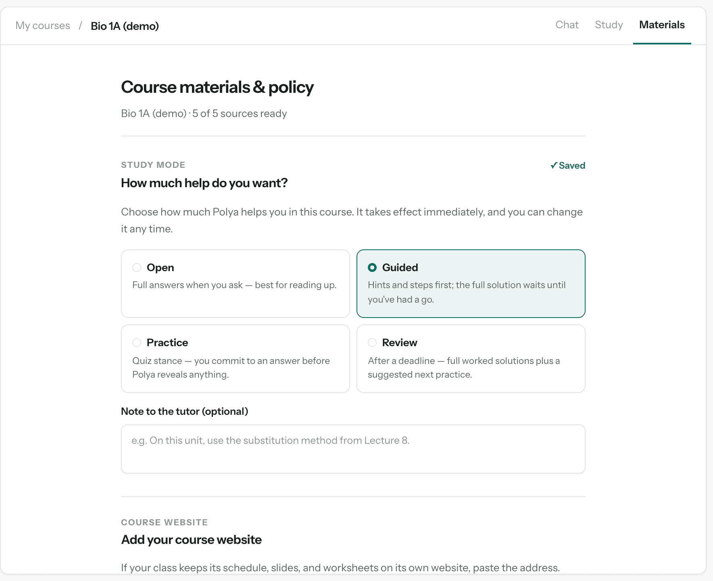
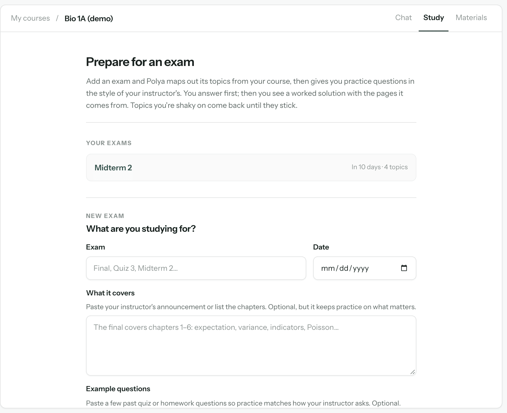
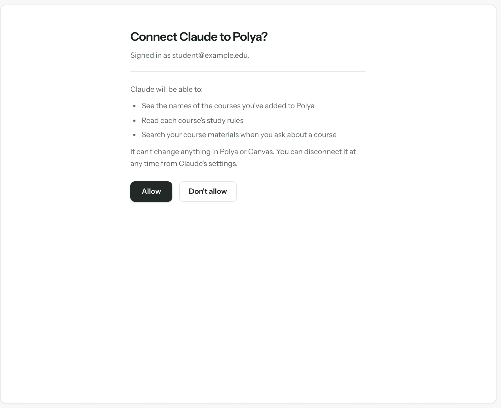
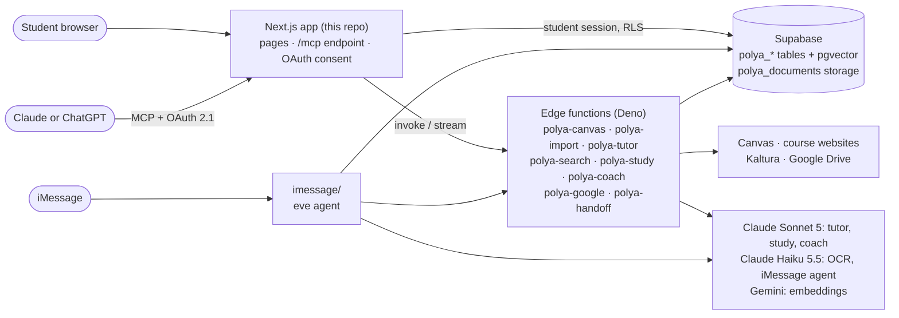

<p align="center">
  
</p>

<p align="center">
  <b>A course-aware tutor that teaches from a student's own class materials and cites every claim.</b><br>
  Polya reads a course's readings, slides, pages, and lecture transcripts, then works through problems with the student instead of handing over answers.
</p>

<p align="center">
  
  
  
  
  
  
  
  
  
</p>

<p align="center">
  <a href="#see-it-work">Demo</a> ·
  <a href="#how-it-works">How it works</a> ·
  <a href="#design-decisions">Design decisions</a> ·
  <a href="#architecture">Architecture</a> ·
  <a href="#tests-and-evals">Tests</a> ·
  <a href="#run-it">Run it</a> ·
  <a href="#known-limitations">Limitations</a>
</p>

> [!NOTE]
> Polya is live at [askpolya.com](https://askpolya.com) and in active development. Today each student chooses the study mode for their own courses. Instructor accounts and instructor-set rules are planned, not built. The screenshots in this README come from the real app, run locally with sample course data, and the tutor replies in them are hand-written samples, not model output.

Polya is named for George Pólya, whose *How to Solve It* taught problem solving through questions. It is the tutor in **Scope**, the course workspace. Company direction lives in `../scope-docs/ROADMAP.md`. Polya is free for students.

## Why

Students already use AI for coursework. A general chatbot doesn't know what their class actually covers, and its default is to finish the work rather than build understanding. Polya starts from the course itself. It answers from the class's own materials, shows where each claim came from, and follows a help ladder: a hint first, then one step, then a worked example of a similar problem, and the full explanation only when that serves the learning.

## See it work

<p align="center">
  
</p>

<sub>Recorded from the real app UI running locally against a stand-in backend loaded with the repo's sample course (`fixtures/demo-course/`). The two replies are hand-written samples, shaped by the tutor's system prompt and streamed through the app's real streaming protocol. They are not live model output.</sub>

## How it works

<table>
  <tr>
    <td width="50%"></td>
    <td width="50%"></td>
  </tr>
  <tr>
    <td valign="top"><b>1. Bring in a course.</b> Connect Canvas with a Canvas access token and pick courses, add the course's own website, or both. Polya reads the files, pages, syllabus, assignments, and module structure. It also pulls lecture-video transcripts from a course's Kaltura gallery, and students can upload transcripts or PDFs.</td>
    <td valign="top"><b>2. Ask, and check the receipts.</b> Every claim carries a numbered citation. Clicking one opens the source beside the answer: the cited PDF page, the course page, or the transcript passage, with its timestamp when the transcript has one.</td>
  </tr>
  <tr>
    <td width="50%"></td>
    <td width="50%"></td>
  </tr>
  <tr>
    <td valign="top"><b>3. Help that teaches.</b> For a problem, Polya climbs one rung per turn: diagnose, hint, one guided step, a worked example of a similar problem, then the full explanation. <i>I'm stuck</i> asks for the next rung. When a course's slides teach a numbered method, Polya walks through those steps, not a generic one.</td>
    <td valign="top"><b>4. Choose how much help.</b> Each course has a study mode. <i>Open</i> gives full answers. <i>Guided</i>, the default, holds back full solutions until the student has had a go. <i>Practice</i> never reveals an answer before the student commits one, and answer keys are withheld from the tutor. <i>Review</i> gives full worked solutions after a deadline.</td>
  </tr>
  <tr>
    <td width="50%"></td>
    <td width="50%"></td>
  </tr>
  <tr>
    <td valign="top"><b>5. Prepare for an exam.</b> Add an exam and what it covers. Polya maps its topics from the course, writes practice questions in the instructor's style, and shows a worked solution with its sources after the student answers. Topics the student is shaky on come back, and the student can take a timed mock exam.</td>
    <td valign="top"><b>6. Use it from Claude or ChatGPT.</b> Polya is also a connector. After the student allows access, the assistant can list their courses, read each course's study rules, and search their materials. The connector is read-only, and Practice mode still withholds answer keys.</td>
  </tr>
</table>

<sub>All screenshots: the real app UI, run locally against a stand-in backend with sample data. Bio 1A (demo) is the repo's synthetic fixture course, and the other course names, the student, and the exam are placeholders.</sub>

### Beyond the website

- **Polya on iMessage** ([`imessage/`](imessage/README.md)): students text Polya for help under the same study modes, and get check-ins about upcoming and newly graded assignments and reminders for exams they added in Study. It is a separate deployable built on the eve agent framework.
- **Open in Polya from Scope**: the Scope browser extension can hand a signed-in student straight to Polya (`polya-handoff`).
- **Gradescope and Google Drive**: students can connect Gradescope for submission-aware reminders, and a course file shared only inside the school's Google domain can be read through the student's Drive grant ([`docs/DRIVE-SETUP.md`](docs/DRIVE-SETUP.md)).

## Design decisions

- **Course files are data, not instructions.** Retrieved passages reach the model inside an explicitly untrusted wrapper, and any text in a course file that would close or forge that wrapper is neutralized first (`supabase/functions/_shared/prompts.ts`). A PDF can't rewrite the tutor's rules.
- **Cite only what the evidence supports.** The tutor may cite `[n]` only from the numbered evidence it was given, and says so when the course doesn't cover a question. Location labels claim only what can be opened: an untimed transcript is a "transcript passage", never a moment.
- **Rules enforced below the prompt where it matters.** Practice mode drops answer-key material at the SQL level, so the tutor never sees it, rather than relying on an instruction to hold it back.
- **Hybrid retrieval, grouped results.** Search runs pgvector similarity and Postgres full-text search per course and fuses them with Reciprocal Rank Fusion. Neighboring passages are merged, and a hit on one step of a numbered method pulls in the whole method, so the professor's procedure comes back intact.
- **Secrets stay server-side.** Canvas access tokens are encrypted at rest (AES-256-GCM) in a table that signed-in users can't read at all, and only edge functions touch them. Model API keys live only in edge-function environments.
- **Careful fetching.** Course-website crawls require HTTPS and a public host on every redirect hop, honor `robots.txt`, and cap size, page count, and time.

Details are in [`docs/ARCHITECTURE.md`](docs/ARCHITECTURE.md). Some of its roadmap items, such as OCR and Kaltura transcripts, have since been built.

## Architecture



The backend is the shared Scope Supabase project. Polya owns only `polya_`-prefixed tables, functions, and storage.

| Folder | What it holds |
|---|---|
| [`src/app/`](src/app/) | Routes: the landing and marketing pages, `/app` (courses, chat, Study, materials), `/connect` (Gradescope, iMessage linking), and `/mcp` with its OAuth metadata routes |
| [`src/components/`](src/components/) | UI: chat and source viewer, exam coach, import flow, study-mode panel |
| [`src/lib/`](src/lib/) | Client and server helpers; [`src/lib/mcp/`](src/lib/mcp/) holds the connector's three read-only tools |
| [`supabase/functions/`](supabase/functions/) | Deno edge functions; `_shared/` holds runtime-agnostic logic that the Node tests import |
| [`supabase/migrations/`](supabase/migrations/) | The `polya_` schema |
| [`imessage/`](imessage/) | Polya on iMessage, deployed separately |
| [`fixtures/`](fixtures/) | The self-authored demo course and Canvas API fixtures, the only committed course content |
| [`scripts/`](scripts/) | Fixture seeding, retrieval and study evals, the import integration test |
| [`tests/`](tests/) | Unit tests for Node's built-in test runner |
| [`docs/`](docs/) | Architecture, positioning, demo script, design brief, SEO, Drive setup |

## Tests and evals

- **Unit tests.** `npm test` runs 521 tests over the shared logic: chunking, retrieval fusion, prompt assembly, prompt-injection handling, token encryption, crawl policy, study grading, and the MCP connector. `npm test` in `imessage/` runs that agent's 363 tests. Both passed on October 26, 2026.
- **Retrieval eval.** `npm run eval` sends the four golden questions in `scripts/eval/golden-set.json` through course search and fails below recall@5 of 0.8. [`docs/DEMO.md`](docs/DEMO.md) records recall@5 = 1.00 and MRR = 1.000 against the synthetic demo course. Four questions over five documents show that the pipeline works end to end. They don't measure retrieval quality on real courses.
- **Study eval.** `npm run eval:study` counts how many generated practice questions pass the automatic answer-key checks, and writes the kept questions out for a person to check by hand. No result is recorded in the repo.
- **Import integration test.** `npm run test:integration` runs a full Canvas import against the local Supabase stack and a mock Canvas server. Its setup steps are in the header of `scripts/integration/run-import-integration.ts`.

## Run it

You need Node.js 22.6 or later (the iMessage agent needs Node 24), npm, and the Supabase CLI for local database work.

```sh
npm install
cp .env.template .env.local   # defaults already point at the shared project
npm run dev                   # http://localhost:3000
```

The defaults point at the **shared** Scope Supabase project, so a dev server signed in with a real account reads and writes real data. For isolated work, run the Polya-only local stack with `supabase start` and `supabase db reset`, and point `NEXT_PUBLIC_SUPABASE_URL` and `NEXT_PUBLIC_SUPABASE_ANON_KEY` at it. To load the sample course into a backend, use `npm run seed:fixture`; [`docs/DEMO.md`](docs/DEMO.md) lists its environment variables.

Checks: `npm run lint` · `npm run typecheck` · `npm test` · `npm run eval`.

> [!WARNING]
> Never run `supabase db push`, `supabase db reset --linked`, `supabase migration repair`, or `supabase db pull` against the linked project from this repo. Three repos share its migration history. Remote changes go through the process in [`CLAUDE.md`](CLAUDE.md).

### Read first

- [`CLAUDE.md`](CLAUDE.md): repo conventions and the hard rules for the shared Supabase project.
- [`docs/ARCHITECTURE.md`](docs/ARCHITECTURE.md): system design (ingestion, retrieval, tutoring, schema).
- [`docs/POSITIONING.md`](docs/POSITIONING.md): product narrative and pitch language.
- [`docs/DEMO.md`](docs/DEMO.md): the scripted demo and reproducible checks.

## Known limitations

- Students set each course's study mode themselves. There are no instructor accounts, assignment-level rules, or timed solution release yet.
- Connecting Canvas means pasting a Canvas access token. There is no LTI 1.3 install or institution admin, and Brightspace isn't supported.
- The Canvas address check is hostname-pattern filtering only, with no DNS-rebinding defense, as `docs/ARCHITECTURE.md` notes.
- Course-website crawls stop at 120 pages, 40 PDFs per page, and 45 seconds, so a large site may import partly.
- The only recorded retrieval eval covers four questions on a five-document synthetic course.

## Credits

Built and run by Noel Sason as part of [Scope](https://github.com/hqscope).
